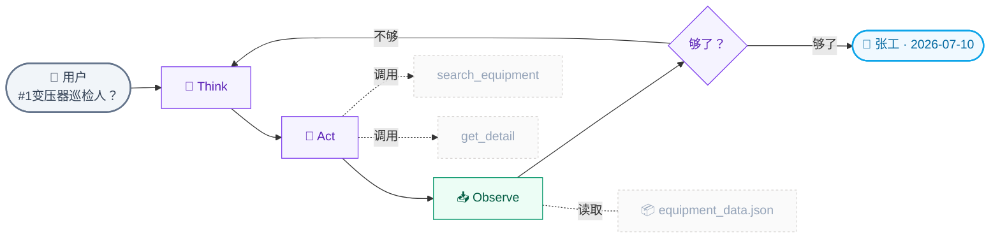
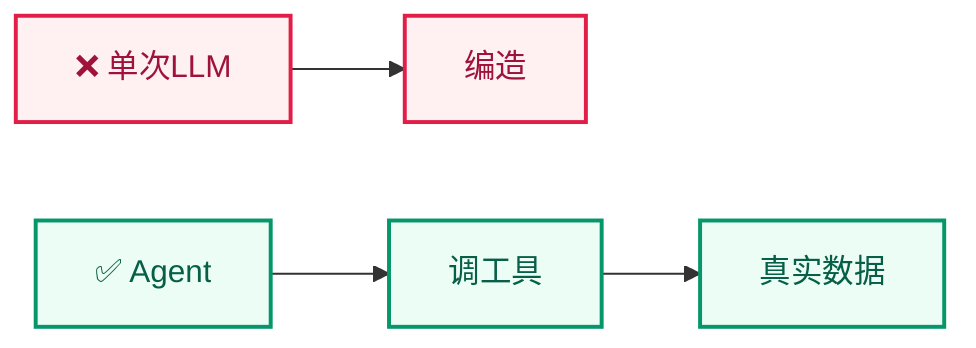

# Lab 7.1 架构图 — ReAct Agent 循环

## 步骤说明

| 步骤 | 节点 | 做什么 |
|:---:|------|------|
| 1 | Think | AI 分析问题，判断需要调哪个工具 |
| 2 | Act | 调用工具，传入搜索关键词 |
| 3 | Observe | 工具返回数据，AI 解读 |
| 4 | 判断 | 够了→回答；不够→回到 Think |
| 5 | 输出 | 自然语言组织答案 |

## 单次 LLM vs Agent

> **排版要点** 工具层和数据层不再各自包 subgraph，而是用虚线从主流程侧边连出——主流程保持横向一条线，工具和数据作为"侧边资源"不抢占纵向空间。
