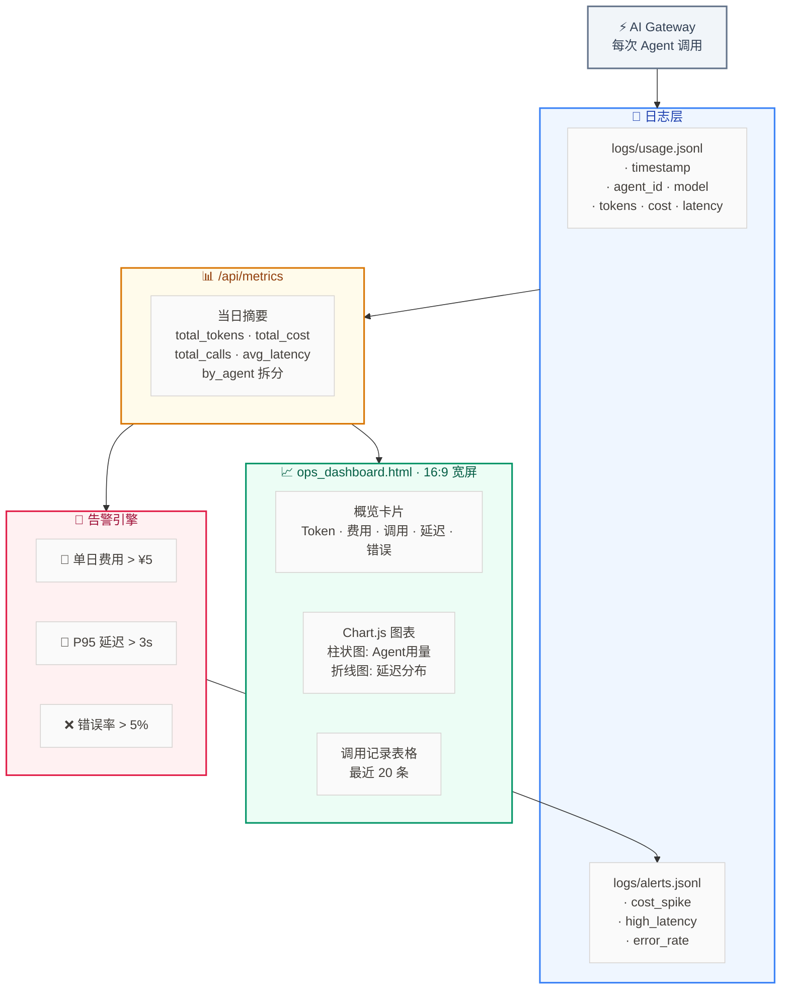

# Lab 7.11 架构图 — Ops 监控 Dashboard

## 监控三层次

| 层次 | 能力 | 本实验 |
|:--:|------|:--:|
| Level 1 | 看得到（Metrics Dashboard） | ✅ Task 1-2 |
| Level 2 | 告得了（Alerting） | ✅ Task 3 |
| Level 3 | 自愈（Auto-Remediation） | 🔲 后续扩展 |
