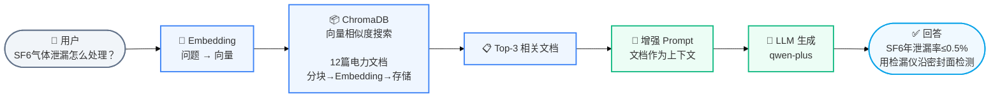
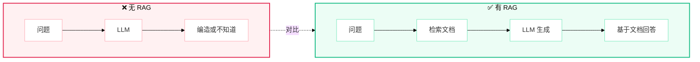

# Lab 7.2 架构图 — RAG 检索增强生成

## 步骤说明

| 步骤 | 阶段 | 做什么 |
|:---:|------|------|
| 1 | 索引构建 | 12 篇文档分块 → Embedding 转向量 → 存入 ChromaDB |
| 2 | 用户提问 | "SF6 气体泄漏怎么处理？" |
| 3 | 检索 | 问题转向量 → ChromaDB 相似度搜索 → Top-3 文档 |
| 4 | 增强 Prompt | 把 3 篇文档拼到 Prompt 里作为上下文 |
| 5 | LLM 生成 | LLM 基于上下文回答（不编造） |

## 有 RAG vs 无 RAG

