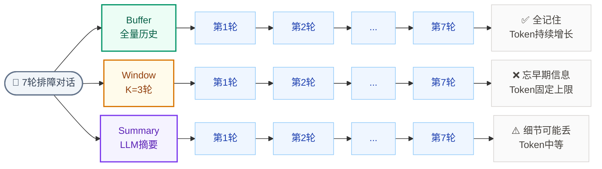

# Lab 7.3 架构图 — Memory 三种策略对比

## 步骤说明

| 步骤 | 做什么 |
|:---:|------|
| 1 | 准备同一段 7 轮排障对话 |
| 2 | 分别用三种 Memory 运行 |
| 3 | 最后一轮问验证问题 |
| 4 | 对比回答正确率和 Token 消耗 |

## 三种策略对比

| 策略 | 原理 | Token | 丢信息？ |
|------|------|:---:|:---:|
| **BufferMemory** | 全量历史 | 持续增长 | 不丢 |
| **WindowMemory** | 最近 K 轮 | 固定上限 | 早期丢失 |
| **SummaryMemory** | LLM 摘要 | 中等 | 细节可能丢 |

> **排版要点** 去除 subgraph 嵌套：三种策略不再各自包一层盒子，而是直接三列并排。`direction LR` 让每列内部从左到右。
