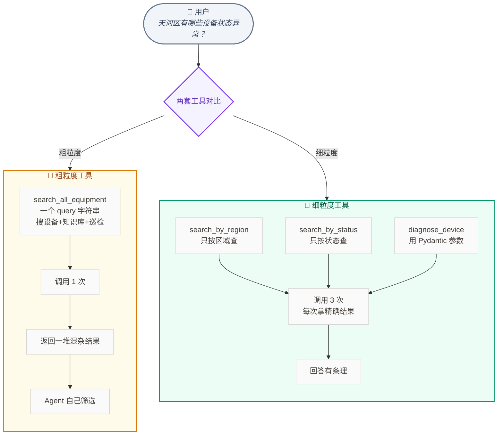
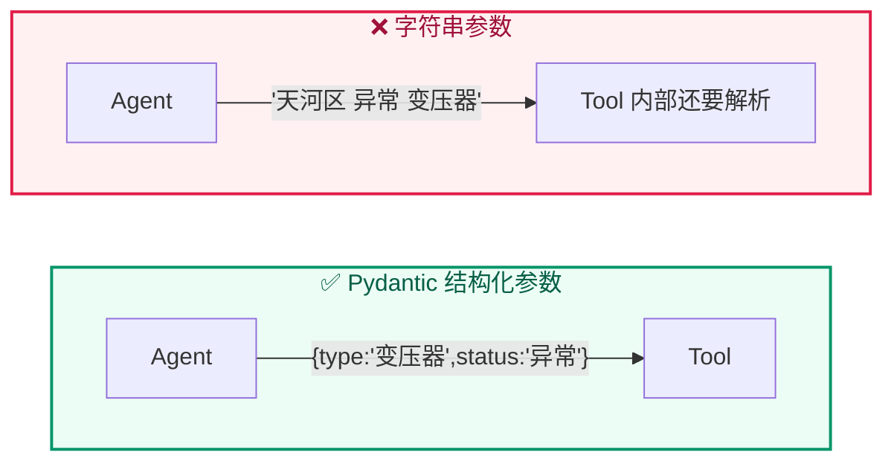

# Lab 7.4 架构图 — Tool Calling 粗粒度 vs 细粒度

## 步骤说明

| 步骤 | 做什么 |
|:---:|------|
| 1 | 实现粗粒度工具组：`search_all_equipment` + `inspect_device` |
| 2 | 实现细粒度工具组：`search_by_type/status/region` + `diagnose_device`（Pydantic 参数） |
| 3 | 同一个任务分别用两套工具跑 |
| 4 | 对比：调用次数、参数准确性、回答完整性 |

## 粗粒度 vs 细粒度 对比

