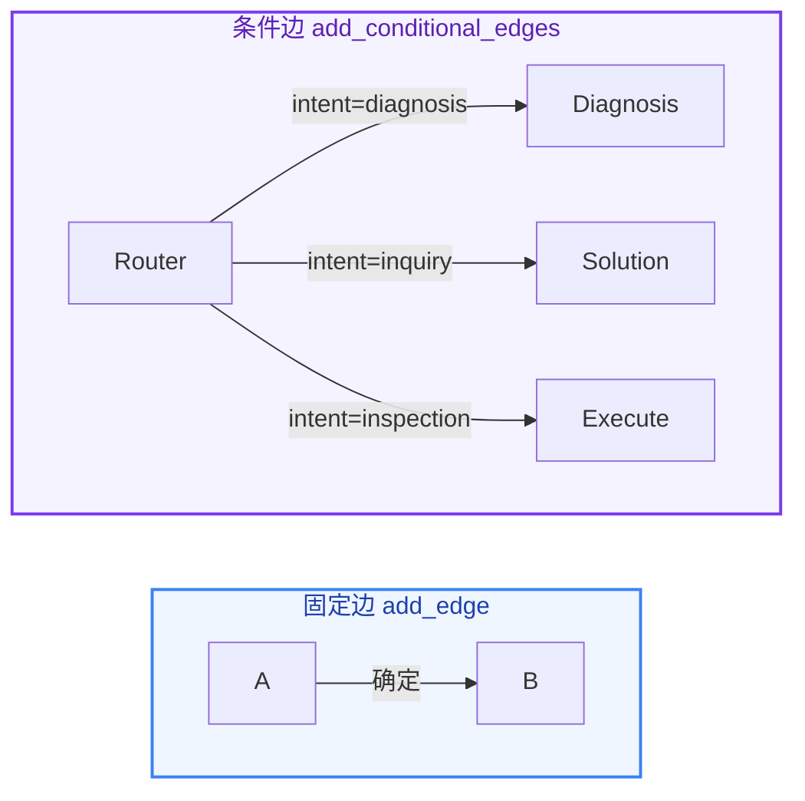

# Lab 7.5 架构图 — StateGraph 工作流编排

```mermaid
%%{init: {'flowchart': {'curve': 'basis'}}}%%
graph TB
    U(["👤 用户<br/><i>EP-D-002 断路器拒分</i>"])
    U --> R

    R["🔍 Router<br/>意图识别 + 提取设备编号"]
    R -->|"diagnosis"| D
    R -->|"inquiry"| S
    R -->|"unknown"| F

    D["🩺 Diagnosis<br/>查设备 + 查知识库<br/>→ 诊断结论 + 严重程度"]
    
    D -->|"critical / warning"| S
    D -->|"normal"| E

    S["📋 Solution<br/>根据诊断结论<br/>→ 生成处置方案"]
    S --> E

    E["✅ Execute<br/>生成巡检记录"]
    E --> END_NODE(["🎯 完成"])

    F["⚠️ Fallback<br/>意图不明时兜底"]
    F --> END_NODE

    STATE["📦 AgentState<br/>user_query · intent · device_id<br/>diagnosis_result · severity<br/>solution · execution_record<br/>messages"]

    R -.- STATE
    D -.- STATE
    S -.- STATE
    E -.- STATE

    classDef user fill:#f1f5f9,color:#334155,stroke:#64748b,stroke-width:2px
    classDef node fill:#eff6ff,color:#1e40af,stroke:#3b82f6,stroke-width:1px
    classDef fallback fill:#fff1f2,color:#9f1239,stroke:#e11d48,stroke-width:1px
    classDef state fill:#fffbeb,color:#92400e,stroke:#d97706,stroke-width:2px,stroke-dasharray: 5 5
    classDef end fill:#ecfdf5,color:#065f46,stroke:#059669,stroke-width:2px

    class U user
    class R,D,S,E node
    class F fallback
    class STATE state
    class END_NODE end
```

## 步骤说明

| 步骤 | 节点 | 做什么 |
|:---:|------|------|
| 1 | Router | LLM 分析输入 → 提取 device_id、symptom、意图 |
| 2 | 条件路由 | diagnosis → 走 Diagnosis；inquiry → 跳过诊断；unknown → Fallback |
| 3 | Diagnosis | 查设备数据 + 查知识库 → 诊断结论 + 严重程度 |
| 4 | 条件路由 | critical/warning → Solution；normal → 跳过方案直接 Execute |
| 5 | Solution | 根据诊断结论生成处置方案 |
| 6 | Execute | 生成巡检记录 JSON，汇总所有信息 |

## 固定边 vs 条件边


