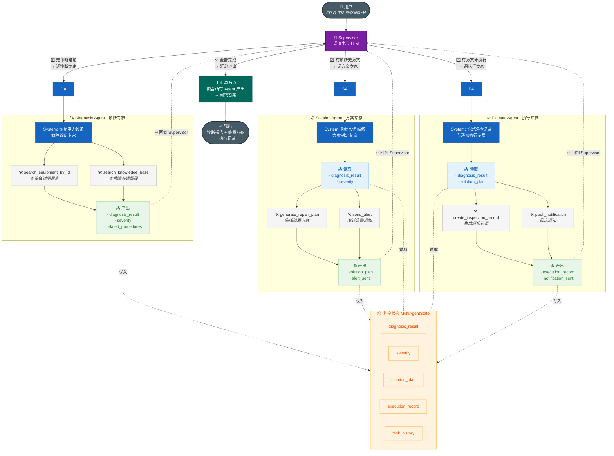
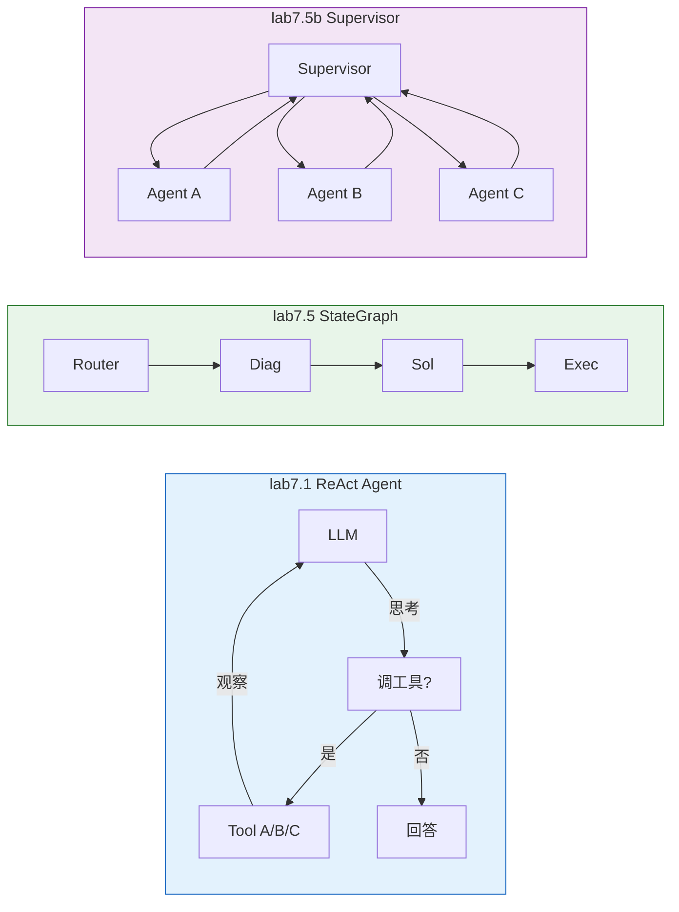

# Lab 7.5b 架构图 — Supervisor 多 Agent 协作模式

## 图例说明

| 颜色 | 含义 |
|------|------|
| 🟣 紫色 | Supervisor 调度中心 |
| 🔵 蓝色 | 各专业 Agent |
| ⬜ 灰色 | Agent 专属工具 |
| 🟢 绿色 | Agent 产出写入 State |
| 🟠 橙色 | 共享状态 / 其他 Agent 读取 |
| 🟦 青色 | 汇总输出节点 |

## 三种模式对比

| 模式 | 决策者 | 路径 | 适用场景 |
|------|:---:|------|------|
| **ReAct Agent** | AI 自主 | 动态 | 开放式探索任务 |
| **StateGraph** | 你（编译时） | 固定 | 有确定流程的任务 |
| **Supervisor** | Supervisor LLM | 半动态 | 需要灵活调度多专家的复杂任务 |
