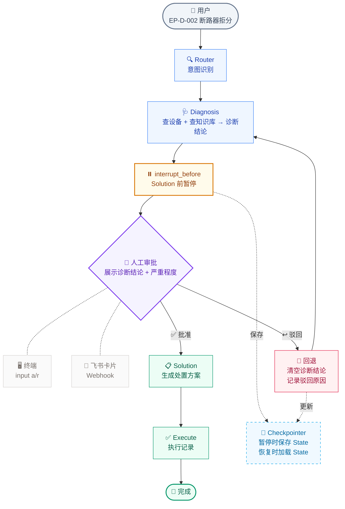
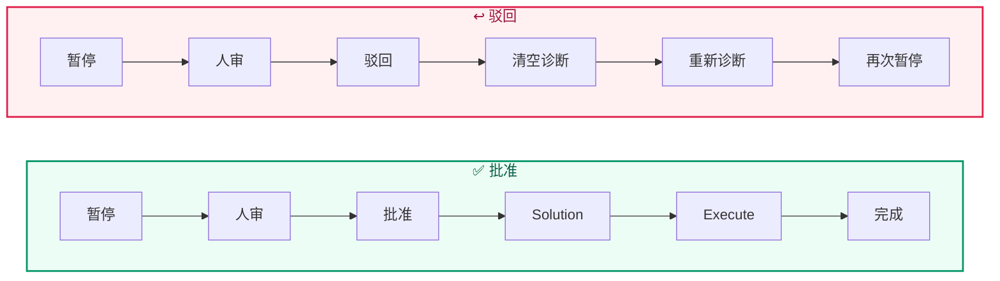
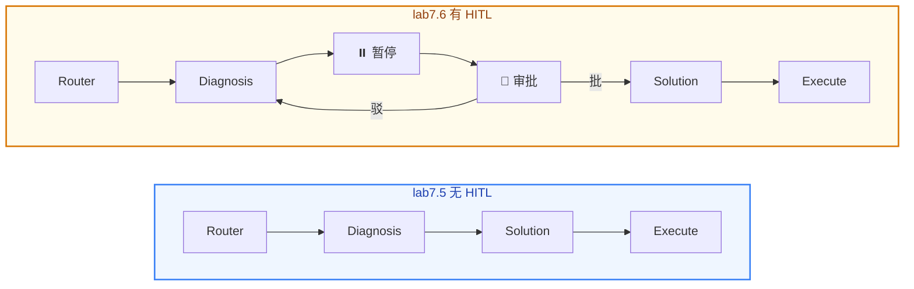

# Lab 7.6 架构图 — Human in the Loop 人工审批

## 图例

| 颜色 | 含义 |
|------|------|
| 🔵 浅蓝 | 工作流节点（Router / Diagnosis） |
| 🟡 浅黄 | 暂停点（interrupt_before） |
| 🟣 浅紫 | 人工审批 |
| 🟢 浅绿 | 批准路径（Solution / Execute） |
| 🔴 浅红 | 驳回路径（回退重诊） |
| ⬜ 浅灰 | 审批通道（终端 / 飞书） |
| 🔷 浅天蓝 | Checkpointer |

## 批准 vs 驳回

| 路径 | 操作 | State 变化 | 下一步 |
|------|------|-----------|--------|
| **批准** | `Command(resume=True)` | 不变 | Solution 继续 |
| **驳回** | `update_state` 清空诊断字段 → `Command(resume=True)` | `diagnosis_result`、`severity` → None | 重新 Diagnosis |

## 无 HITL vs 有 HITL

| 维度 | 无 HITL | 有 HITL |
|------|:---:|:---:|
| 执行方式 | 全自动 | 中间暂停等人审批 |
| 人能介入吗 | ❌ | ✅ 批准 / 驳回 / 修改 |
| 出错处理 | 跑完再改 | 驳回后立即重新诊断 |
| 适合场景 | 自动巡检、批量处理 | 关键设备诊断、停机决策 |
