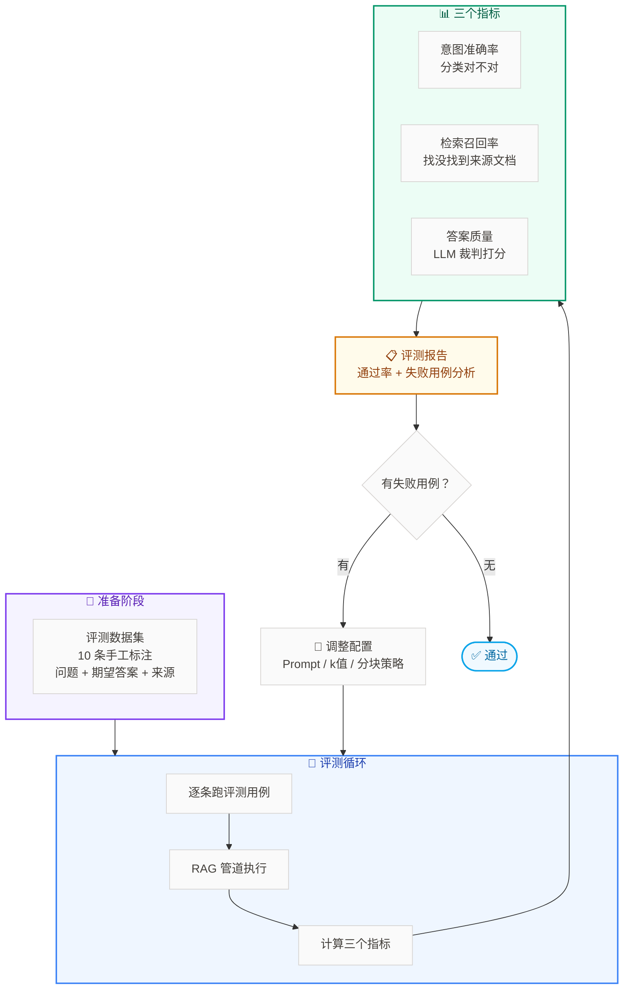

# Lab 7.7 架构图 — Evals 评测体系

## 步骤说明

| 步骤 | 做什么 |
|:---:|------|
| 1 | 基于 12 篇知识库文档，手工标注 10 条评测用例 |
| 2 | 实现意图准确率、检索召回率、答案质量三个指标 |
| 3 | 跑评测循环，每条用例记录分数 |
| 4 | 分析失败用例，定位根因（检索没召回？LLM 编造？） |
| 5 | 调整配置（Prompt、k 值、分块策略等），重新评测 |
| 6 | 对比调整前后的分数变化 |
