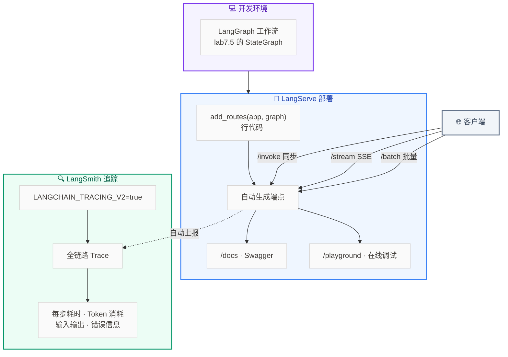
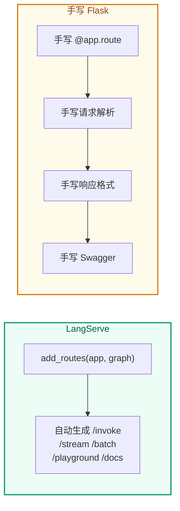

# Lab 7.8 架构图 — LangServe 部署 + LangSmith 追踪

## 步骤说明

| 步骤 | 做什么 |
|:---:|------|
| 1 | 基于 lab7.5 的 `build_graph()` 创建 graph |
| 2 | `add_routes(app, graph, path="/api/diagnosis")` 一行部署 |
| 3 | 访问 `/docs` 查看自动 Swagger，`/playground` 在线调试 |
| 4 | 配置 `LANGCHAIN_TRACING_V2=true` 开启追踪 |
| 5 | 在 LangSmith 控制台查看每条请求的完整调用链 |

## LangServe vs 手写 Flask

