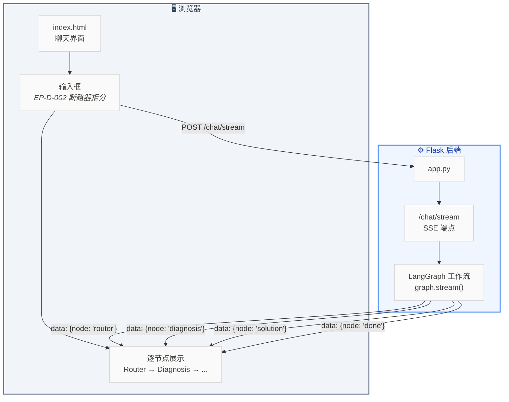
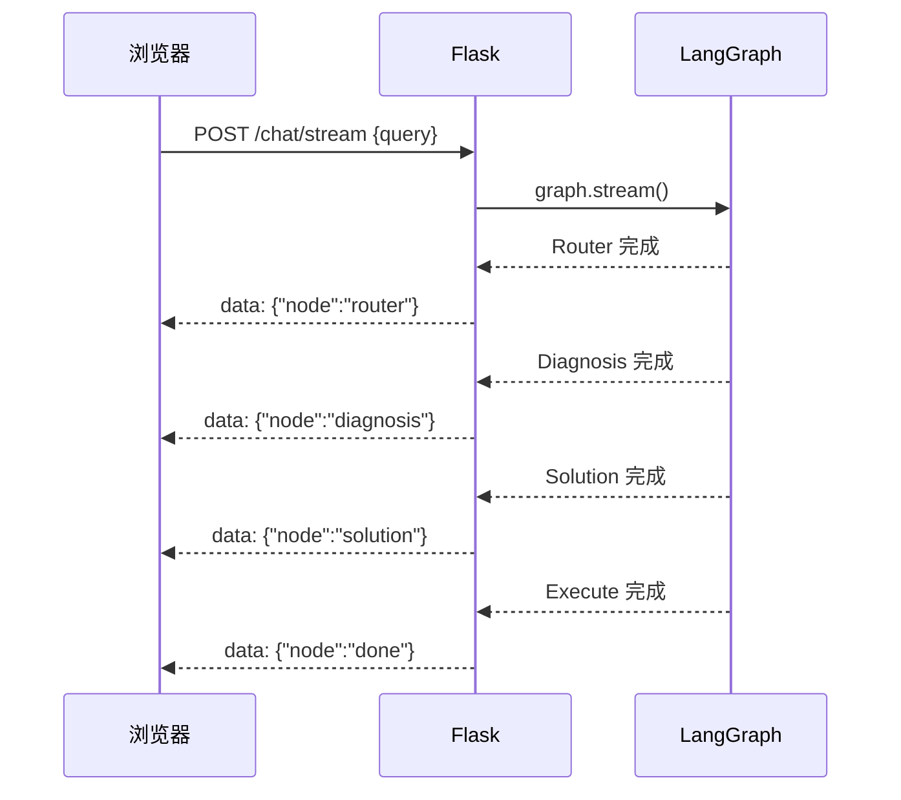

# Lab 7.9 架构图 — Web UI Flask 封装

## 步骤说明

| 步骤 | 做什么 |
|:---:|------|
| 1 | 创建 Flask 应用，定义 `/chat/stream` SSE 端点 |
| 2 | 在 `generate()` 函数中调用 `graph.stream()`，每个节点完成 → `yield` 一条 SSE 消息 |
| 3 | 写 `index.html`：输入框 + 聊天区域 + EventSource 接收 SSE |
| 4 | 浏览器逐节点展示执行过程：Router → Diagnosis → Solution → Execute |
| 5 | （选做）根据 severity 用不同颜色展示诊断结果卡片 |

## SSE 数据流

