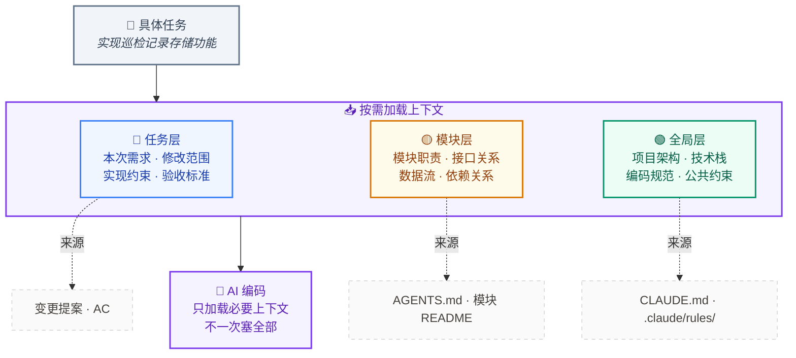

# 三层上下文模型



## 三层说明

| 层 | 内容 | 时机 | 载体 |
|------|------|------|------|
| **全局层** | 项目架构、技术栈、编码规范 | 每次对话自动加载 | CLAUDE.md · Rules |
| **模块层** | 模块职责、接口、数据流 | 涉及该模块时加载 | AGENTS.md · 模块 README |
| **任务层** | 具体需求、修改范围、AC | 执行具体任务时加载 | OpenSpec · PRD |

## 核心原则

```
不是"把所有文档喂给 AI"，而是"按任务需要，渐进式注入上下文"
```
