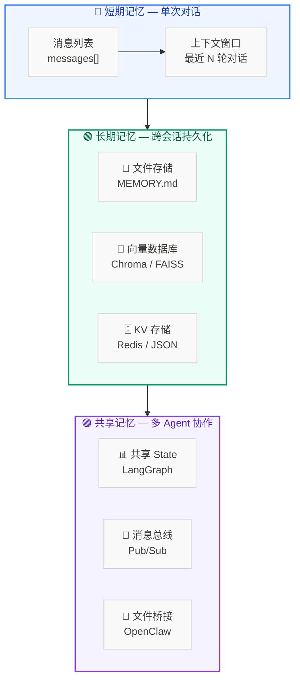
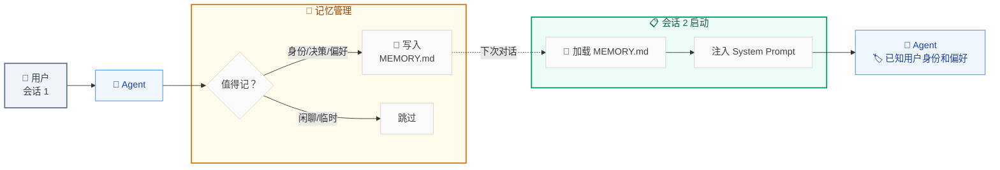
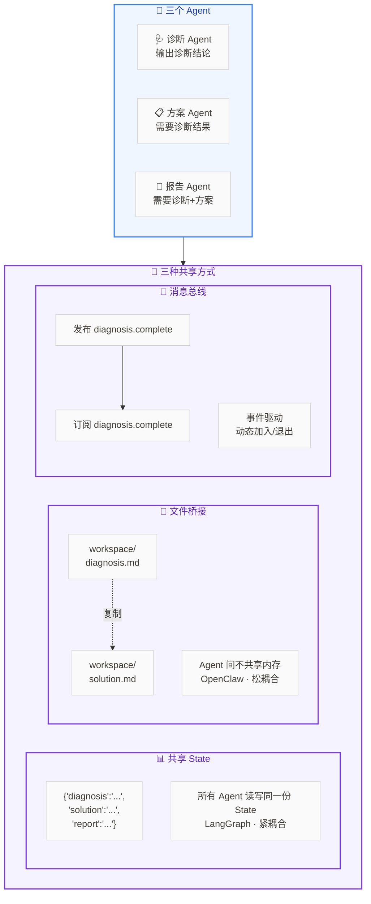
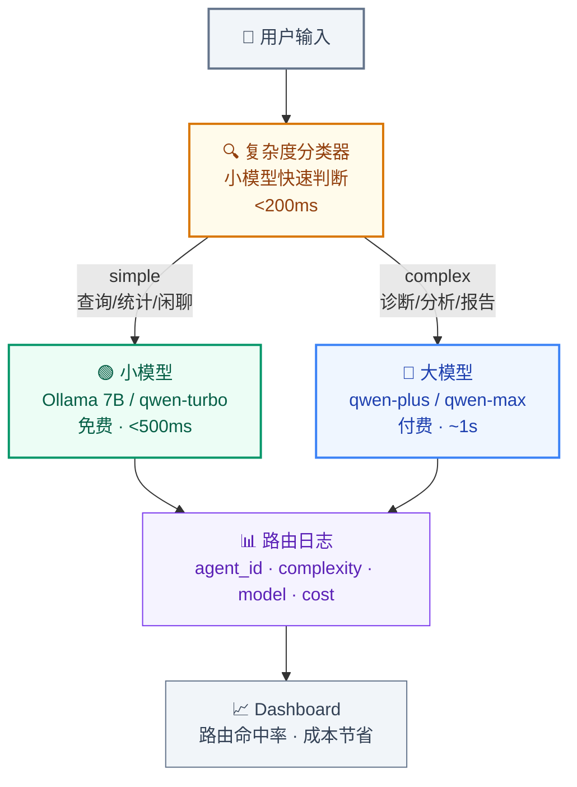
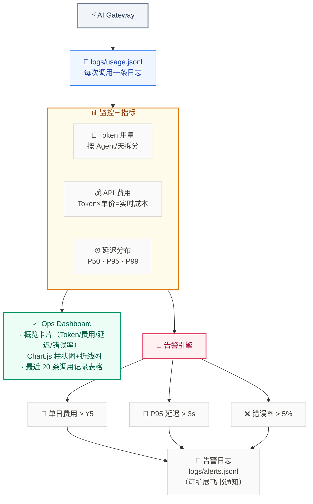

# 知识点：Agent Memory 体系

> 跨会话持久记忆 · 多 Agent 共享记忆 · 知识图谱

---

## 架构总览



---

## 一、跨会话持久记忆



---

## 二、多 Agent 共享记忆



---

## 三、多智能体知识图谱

```mermaid
%%{init: {'flowchart': {'curve': 'basis'}}}%%
graph TB
    subgraph QUERY["🔍 查询方式"]
        direction LR
        Q1["直接查询<br/>'2号断路器在哪'"]
        Q2["关系查询<br/>'梅花站有哪些设备'"]
        Q3["推理查询<br/>'线圈烧毁→影响哪些设备'"]
    end

    subgraph GRAPH["🕸 知识图谱"]
        direction LR
        N1["(梅花变电站)"]
        N2["(2号断路器)"]
        N3["(分闸线圈)"]
        N4["(烧毁)"]
        N1 --"包含"--> N2
        N2 --"包含"--> N3
        N3 --"故障模式"--> N4
    end

    subgraph TOOLS["🔧 Agent Tools"]
        direction LR
        T1["query_node(id)<br/>查一个实体"]
        T2["query_neighbors(id)<br/>查一跳邻居"]
        T3["query_path(from,to)<br/>最短路径"]
    end

    QUERY --> GRAPH
    GRAPH --> TOOLS
    TOOLS --> ANSWER["✅ 回答<br/>'线圈烧毁→影响2号断路器<br/>→影响梅花变电站220kV供电'"]

    classDef query fill:#f1f5f9,color:#334155,stroke:#64748b,stroke-width:2px
    classDef graph fill:#eff6ff,color:#1e40af,stroke:#3b82f6,stroke-width:2px
    classDef tools fill:#fffbeb,color:#92400e,stroke:#d97706,stroke-width:2px
    classDef answer fill:#ecfdf5,color:#065f46,stroke:#059669,stroke-width:2px
    classDef node fill:#fafafa,color:#44403c,stroke:#d6d3d1,stroke-width:1px

    class QUERY query
    class GRAPH graph
    class TOOLS tools
    class ANSWER answer
    class Q1,Q2,Q3,N1,N2,N3,N4,T1,T2,T3 node
```

---

## 四、模型路由



---

## 五、Ops 监控



---

## 六、三种记忆方案对比

| 维度 | 短期记忆 | 长期记忆 | 共享记忆 |
|------|:--:|:--:|:--:|
| 存储位置 | 内存（messages list） | 文件/向量库/KV | State / 文件 / 消息总线 |
| 生命周期 | 单次对话 | 跨会话持久化 | 跨 Agent、跨会话 |
| 检索方式 | 顺序读取 | 语义检索 / Key 查询 | 读写 State / Pub-Sub |
| 代表实现 | LangChain Memory | MEMORY.md / Chroma | LangGraph State / OpenClaw Bridge |

## 七、快速上手建议

| 阶段 | 做什么 | 技术选型 |
|------|------|------|
| **Level 1** | 跨会话记忆 | JSON 文件 + LLM 自主判断写入 |
| **Level 2** | 多 Agent 共享上下文 | LangGraph State 共享 |
| **Level 3** | 语义相似记忆检索 | 向量数据库（Chroma / FAISS） |
| **Level 4** | 设备关系推理 | JSON 知识图谱 + 图查询 Tool |
| **Level 5** | 全企业知识图谱 | Neo4j / 图数据库（生产级） |
